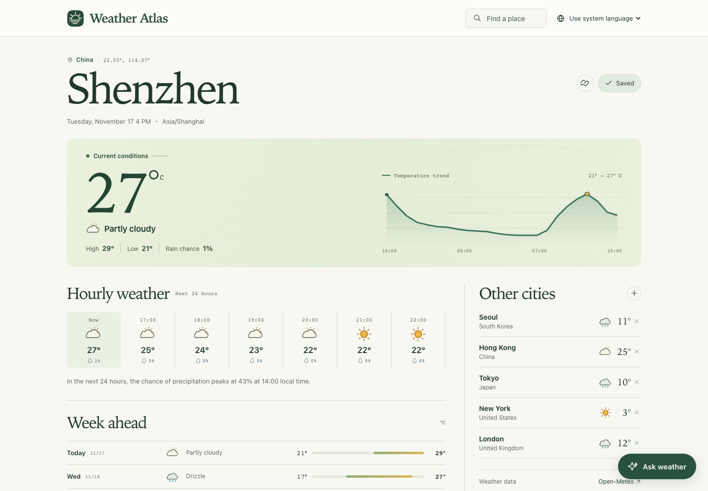
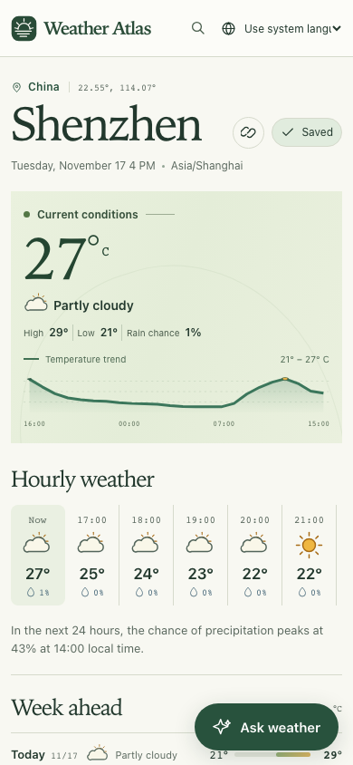
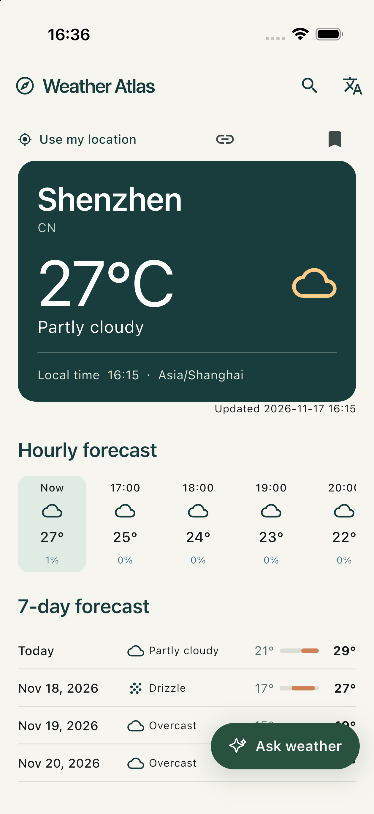
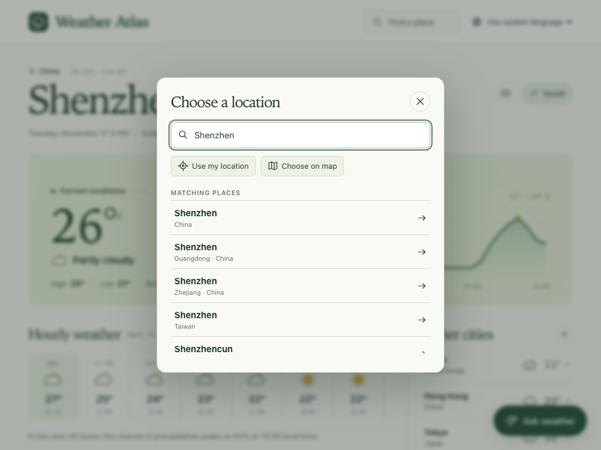
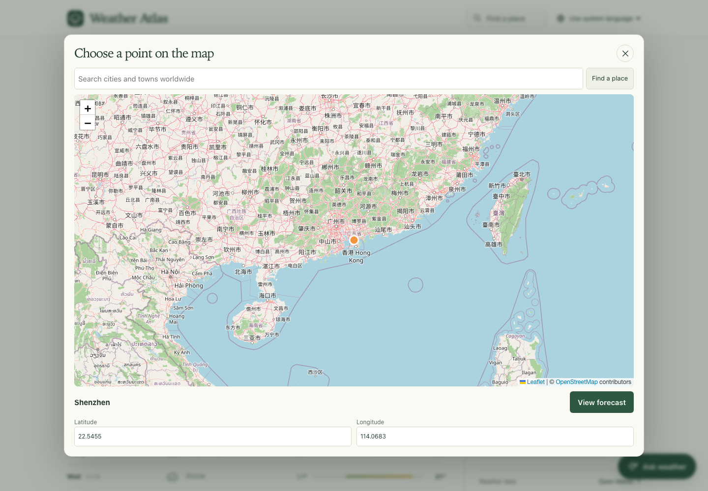
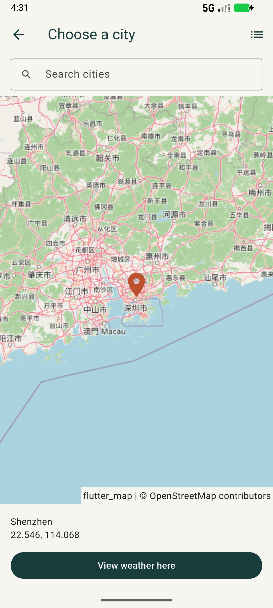
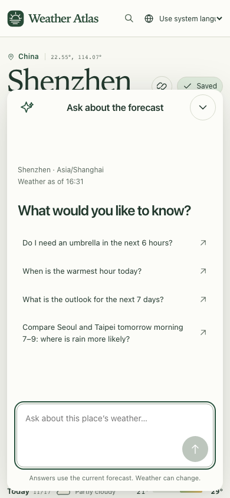
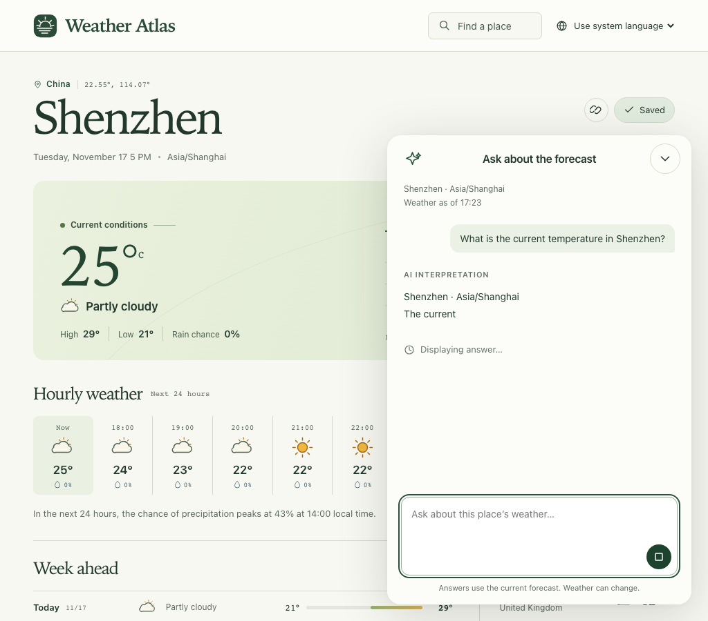
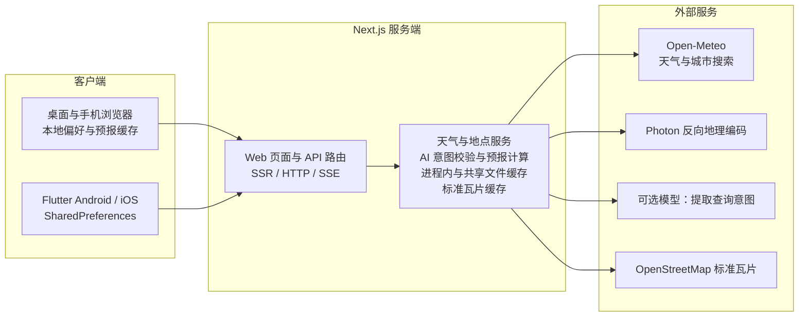

# Weather Atlas

用同一套天气服务连接 Web、Android 和 iOS：搜索或定位一个地点，查看当前天气、未来 24 小时和 7 天预报，再通过带预报依据的 AI 问答安排出行。

Web 使用 **Next.js、React 和 TypeScript**，移动应用使用 **Flutter 和 Dart**。选择 Next.js 的主要目的是 **SEO 优化**：通过服务端渲染输出可抓取的天气正文，并管理城市与语言页面的元数据。移动端的性能要求不高，选择 Flutter 主要看重**跨端开发效率**，用一套代码覆盖 Android 和 iOS。支持简体中文、繁体中文、英文、韩文，时间按目的地时区显示。项目从天气查询的核心流程出发，逐步补充地图、缓存、可追溯问答和公开城市页，设计重点是数据一致性、明确的失败状态与可维护的边界。

## 主要功能

| 功能 | 桌面 Web / 手机浏览器 | Flutter Android / iOS |
| --- | --- | --- |
| 搜索地点 | 全球搜索、同名城市区分、空结果与重试 | 同一搜索服务，支持搜索与地图入口 |
| 使用当前位置 | 浏览器定位、授权与失败恢复；手选和城市深链优先 | 系统定位权限、前后台恢复、分类失败提示 |
| 查看天气 | 当前天气、温度走势、24 小时横滑、7 天预报 | 当前天气、24 小时横滑、7 天预报 |
| 地图选点 | 按需加载，拖动选点，确认后查询天气 | 地图搜索、平移缩放、确认选点 |
| 坐标名称 | 自动显示城市；失败回退到区域或坐标 | 相同规则，名称恢复不改变天气查询坐标 |
| 其他城市 | 本地收藏、天气摘要、切城与分享链接 | 本地收藏、天气摘要、切城与城市链接 |
| 四语切换 | 页面、搜索、天气描述、日期、地图控件与问答 | 相同语言范围，支持跟随系统 |
| AI 天气问答 | 当前或指定城市、双城市比较、连续追问、依据跳转 | 使用同一接口与上下文规则，依据可打开相应城市预报 |
| SDK 与对话交互 | Vercel AI SDK：SSE 流式接收、逐字显示、中断生成、失败重试；发送后清空输入 | `ai_ui_stream`：接入同一 SSE 协议，支持逐字显示、中断生成、失败重试；保留独立草稿 |
| 加载与错误 | 首次加载、切城骨架、缓存时间、更新中与失败恢复 | 加载、旧数据提示、权限分类与手动重试 |
| 公开页面 | 服务端天气正文、四语 SEO、城市深链、性能采集 | 分享到对应语言的 Web 城市页 |

收藏和偏好保存在当前设备，没有账户与跨设备同步。

## 界面截图

天气是拍摄时的数据，不能作为当前预报使用。Web 截图来自本机生产服务，原生截图来自实际模拟器；设备、构建及来源见[截图说明](docs/images/README.md)。

### 天气预报



<table>
  <tr><th>手机浏览器</th><th>Flutter · iOS</th></tr>
  <tr>
    <td valign="top"></td>
    <td valign="top"></td>
  </tr>
</table>

### 地点搜索与地图选点

点击顶部的 **Find a place**（窄屏为搜索图标），输入 `Shenzhen`，在 **Matching places** 中按国家和区域辨认目标城市，点击结果即可查看天气。



选择 **Choose on map** 可以搜索或拖动地图选点，点击确认按钮后查询该坐标的天气。

<table>
  <tr><th>Web</th><th>Flutter · Android</th></tr>
  <tr>
    <td valign="top"></td>
    <td valign="top"></td>
  </tr>
</table>


### AI 天气问答

右下角的 **Ask weather** 是 AI 天气问答入口。Web 接入 **Vercel AI SDK**，Flutter 接入 **`ai_ui_stream`**，支持 **SSE 流式接收、逐字显示、中断生成和失败重试**。可以这样提问：

- “未来 6 小时需要带伞吗？”“今天最暖和的是几点？”
- “出门穿什么衣服？要带外套吗？”
- “下午适合跑步、骑行或出游吗？”
- “今天可以晾衣服吗？”“会下雪吗？”
- “深圳和香港明天早上 7–9 点，哪里更容易下雨？”

问过“今天深圳天气怎样？”后，可以继续追问“出门穿什么衣服？”“明天呢？”“那下午呢？”，沿用城市并逐步调整日期与时段。回答附带可点击的预报依据；失败时问题保留在对话历史，重试不会覆盖输入框中的新草稿。



提交深圳气温问题后，页面逐字显示回答，并保留停止按钮。下图采集自本机实际服务的答题过程：



## 架构设计



服务端统一处理上游访问、数据校验、缓存和 AI 凭据，两端通过 HTTP 契约共享天气语义。Web 首屏由服务端输出可读预报，再接管交互；Flutter 通过 API 获取同样的快照。模型参与理解问题，天气数值由服务端从预报中计算。

### 1. 应用程序架构

**为 SEO 选择 Next.js。** 城市天气需要能从搜索结果直接进入，因此使用服务端渲染，让原始 HTML 包含城市名称、当前天气和预报正文，搜索引擎无需等待客户端取数才能获得页面内容。通过 Next.js 的元数据与路由能力管理标题、描述、canonical、hreflang、结构化数据及 sitemap，使不同城市和语言有明确的公开地址。代价是服务端需要承担天气获取、缓存与渲染成本，并处理上游不可用时的页面和索引策略。

**为跨端开发效率选择 Flutter。** 天气查询、预报列表、地图选点和问答是本项目的主要交互，性能要求不高，因此优先复用 Android 与 iOS 的界面、状态管理和 API 接入，减少两套原生实现的开发与维护成本。代价是定位权限、前后台行为、构建和签名仍有平台差异，需要分别适配和验收；一套代码不能替代两端运行验证。

**将服务端天气服务作为共同边界。** 在 SEO 页面服务的基础上，复用 Next.js API 路由为 Web 和 Flutter 提供统一天气服务，避免两端对字段、时区、缓存和缺测形成两套解释。统一 API 与减少部署单元是附带收益；原生应用也因此依赖该服务的可用性，未来拆服务时仍需保持 HTTP 契约。

**公开页面与个人状态分开。** 城市 URL 提供稳定的 SSR 天气正文与元数据；当前位置、收藏和聊天在客户端管理。搜索引擎进入深圳等城市深链时，不用自动定位替换 URL 指定的城市。任意坐标放在 `explore` 页面，避免无限坐标组合进入索引。

对应代码：[城市页面](web/app/[locale]/weather/[slug]/page.tsx)、[服务端页面](web/components/ServerScreen.tsx)、[天气服务](web/lib/weather.ts)、[Flutter 入口](mobile/lib/main.dart)。

### 2. 组件设计

Web 按用户任务拆分：`Forecast` 展示预报，`OtherCities` 管理其他城市，`SearchDialog` 搜索，`MapDialog` 选点，`AskDialog` 对话。`Modal` 与 `FloatingPanel` 统一弹层行为，图标、日期格式和四语文案集中维护。地图代码按需加载，天气首页不先下载瓦片。

Flutter 使用独立的地点选择页、问答页和天气入口组件，复用 `WeatherController`、`WeatherApi` 与语言工具。页面负责布局，数据层负责解码，控制器负责切城、刷新和偏好恢复。两端复用契约与交互规则，分别保留适合浏览器和原生系统的界面。

组件以明确的数据和回调协作。当前 Flutter 主页面仍集中在 `main.dart`；继续增加复杂交互时，应优先提取展示组件，避免将更多网络状态塞进页面。

对应代码：[Web 组件](web/components)、[Flutter 地点选择](mobile/lib/location_picker.dart)、[Flutter 问答](mobile/lib/questions.dart)、[原生问答入口](mobile/lib/weather_ask_button.dart)。

### 3. 状态管理

| 状态 | 所属位置 | 处理原则 |
| --- | --- | --- |
| 当前城市与语言深链 | Web URL | 刷新、分享和前进后退可以恢复公开页面 |
| 收藏、语言偏好、最近地点 | 浏览器存储 / SharedPreferences | 本地持久化，恢复时校验内容 |
| 天气、加载、错误与重试时间 | Web `useWeatherQuery` / Flutter `WeatherController` | 按坐标及数据来源隔离缓存，管理请求生命周期 |
| 搜索词、地图视野、待确认图钉 | 对应弹层或页面 | 未确认前不改变当前天气地点 |
| 消息、草稿、生成状态 | Web AI SDK / Flutter 对话状态 | 草稿独立于失败消息；停止同时结束接收与逐字显示 |
| 追问上下文 | 请求携带，服务端校验 | 保留城市、日期、时段和指标，绑定预报版本 |

竞态通过请求取消、递增序号和地点身份校验控制。用户在定位返回前选择深圳，迟到的定位不能覆盖手选；快速输入只接受当前查询结果；切城先切换相应天气状态，避免把旧温度与新城市名拼到同一屏。

没有为有限的页面状态引入额外全局状态库。代价是异步约束需要集中在 Hook 与控制器，并用跨请求的回归测试保护，不能散落在按钮事件里。

对应代码：[Web 天气状态](web/components/useWeatherQuery.ts)、[客户端快照策略](web/lib/client-forecast.ts)、[Flutter 控制器](mobile/lib/controller.dart)。

### 4. API 整合

| 接口 | 职责 |
| --- | --- |
| `GET /api/places?q=Shenzhen&lang=en` | 全球搜索，返回可区分的地点信息 |
| `GET /api/weather?lat=22.5455&lon=114.0683` | 当前天气、24 小时、7 天与快照版本 |
| `GET /api/weather?...&fresh=1` | 过期时等待共享刷新；仍复用新鲜缓存 |
| `GET /api/reverse?lat=22.5455&lon=114.0683&lang=en` | 将坐标解析为城市或区域名称 |
| `GET /api/summaries?coords=22.5455,114.0683;37.566,126.9784` | 复用预报并批量补齐摘要，单批最多 20 点 |
| `POST /api/ask` | 问答、比较与追问；支持 SSE，保留 JSON 兼容路径 |
| `POST /api/vitals` | 接收受限的 Web 性能指标 |

预报契约使用 Unix 时间表示小时对应的时刻，用 IANA 时区转换为目的地当地时间，每日预报保留当地日历日期。降水概率缺失使用 `null`，不能当作 `0%`。Web 与 Dart 各自验证协议，并用[共同契约样例](contracts/forecast-cases.json)覆盖同一组边界。

问答流程为：**提取意图 → 解析城市 → 校验日期、时区、时段和字段 → 获取快照 → 计算数值 → 返回四语答案和依据**。比较深圳与香港明早 7–9 点时，默认按两地各自当地时间；指定同一绝对时刻时按要求对齐。追问“下午呢”保留城市与指标，“哪个更冷”保留城市与时段，改变指标。依据携带相应城市及预报版本，点击后定位到相关小时或日期。

Web 使用 Vercel AI SDK，Flutter 使用 `ai_ui_stream` 消费同一 SSE 协议。服务端先发送阶段进度，完成校验和计算后发送答案，客户端对收到的文字逐字显示。这能尽早反馈进度并保证数值与依据一致，代价是正文并非模型原始 token 的实时转发。逐字显示不增加模型调用。

配置密钥时使用真实模型，未配置时使用明确标识的规则模式。模型超时或限流会提示失败并允许重试，不静默切换解释来源。最终回答受预报字段和计算规则约束，因此不能承诺任意天气知识问答。

对应代码：[类型](web/lib/types.ts)、[协议校验](web/lib/contracts.ts)、[问答](web/lib/ask.ts)、[单城问答](web/lib/single-city.ts)、[双城比较](web/lib/comparison.ts)、[SSE](web/lib/ask-stream.ts)、[Flutter 数据层](mobile/lib/data.dart)、[Flutter 流式适配](mobile/lib/weather_chat.dart)。

### 5. 代码组织

```text
web/
  app/                  页面路由、元数据、API 入口
  components/           天气、城市、地图、对话与客户端状态
  lib/                  天气领域、协议、缓存、时区、问答与上游适配
  tests/                服务端、契约与客户端策略回归
mobile/
  lib/                  Flutter 页面、控制器、API 与语言工具
  test/                 数据、状态与组件测试
  integration_test/     设备或模拟器流程
contracts/              两端共用的协议测试样例
qa/                     浏览器、网络、性能、SEO 与设备验收及报告
docs/                   设计规格、任务、验收摘要和截图
tools/                  格式化、类型审计与交付工具
.github/workflows/      Web 质量检查与移动构建交付
```

路由层保持薄，只解析输入并调用领域服务，天气计算、缓存与问答规则集中在 `lib`。TypeScript 和 Dart 分别实现客户端，不跨语言共享运行时代码。共享 JSON 样例能降低行为分叉，但两端解码器和交互仍需分别维护、分别验收。

### 6. 错误处理

| 场景 | 用户看到的状态 | 设计理由 |
| --- | --- | --- |
| 首次加载没有数据 | 加载反馈；失败后显示原因与重试 | 不使用演示数据伪装实时天气 |
| 已有天气，后台更新中 | 保留预报与更新时间，显示更新状态 | 更新进行中不等于刷新失败 |
| 刷新失败但旧数据仍可用 | 保留带时间标记的预报，提供重试 | 弱网下仍能阅读，同时明确时效 |
| 旧数据超过使用上限 | 显示不可用状态 | 不无限延长旧预报的可信度 |
| 定位未授权、服务关闭、超时 | 分类提示，保留手动搜索 | 定位是可选入口，不能阻断查天气 |
| 城市名称解析失败 | 区域或坐标；有界重试 | 地名请求不阻塞原坐标天气 |
| 问答快照版本过期 | `409`，刷新相应城市后继续 | 防止答案引用已经替换的预报 |
| 某个比较城市缺测 | 指明缺失城市或字段 | 不补造数值，不混用城市数据 |
| 模型或天气上游不可用 | 对应错误与重试，问题保留在历史 | 不笼统归因，也不覆盖输入草稿 |

天气新鲜期为 **15 分钟**，旧数据上限为 **3 小时**。页面可展示有标记的旧数据，AI 计算要求新鲜依据。服务端支持旧数据先返回、后台刷新；要求等待刷新的请求在上游超时后才回退，因此冷缓存、暖缓存和显式刷新会有不同延迟。

反向地理编码与天气缓存独立：成功名称缓存 7 天；确实没有覆盖时短期记忆空结果；临时网络失败使用更短退避。旧名称恢复与重试预算均有边界，避免每次渲染重复请求，也避免一次失败长期隐藏地名。

对应代码：[共享缓存](web/lib/shared-store.ts)、[反向地理编码](web/lib/reverse.ts)、[服务错误](web/lib/service-errors.ts)、[天气请求](web/lib/weather-request.ts)、[定位](web/lib/device-location.ts)。

### 7. 可维护性与验证

维护策略围绕容易产生用户可见错误的边界：协议、地点身份、时间语义、缓存新鲜度、竞态和预报依据。严格类型、运行时解码和 Flutter 分析各有用途，编译通过不能代替浏览器、模拟器与真实上游验收。

自动化覆盖跨午夜、夏令时、缺失降水、过期版本、切城慢响应、拒绝定位、名称恢复和输入草稿。受控服务稳定复现超时与缺测，真实天气和模型验证独立记录。最近的[Review 验收](docs/verification/review-repairs.md)记录了 151 项 Web、20 项 QA、当时工作区 104 项 Flutter 测试及生产浏览器检查，具体输入和时间以该报告为准。这次 README 改写不代表重新执行整套业务验收。

Web 性能采集记录 LCP、INP、CLS 及页面类型、语言和设备类别，不采集精确定位或问答正文。受控访问只能证明采集链路，真实用户 p75 需要足够样本和观察窗口。地图实验同时记录首屏传输收益与首次打开地图的等待成本，避免只挑有利指标。

## 性能优化

优化重点是减少重复请求、提前准备可能访问的内容，并保持天气版本与地点一致。

| 优化 | 实现与效果 | 控制与取舍 |
| --- | --- | --- |
| 其他城市预取 | 使用 Next.js `Link` 完整预取动态城市页；收藏前两项进入视野并停留后，在浏览器空闲时准备，点击复用路由缓存 | 按 URL 去重、限制候选和缓存时间；更多城市在悬停／聚焦／触摸时准备；省流量、离线、弱网及页面隐藏时限制预取，避免收藏越多请求越多 |
| 天气共享缓存 | 进程内缓存与共享文件缓存配合请求租约，同机多实例、并发及重启后复用已有快照；15 分钟新鲜期，3 小时旧数据上限 | 过期数据带时间标记、后台刷新，失败时有界回退；真正空缓存仍需等待上游，多主机部署需兼容共享存储 |
| 合并重复读取 | React 请求级 `cache()` 合并同次 SSR 的 metadata 与天气正文读取；客户端刷新等待已有共享任务 | 保留完整原始 HTML 与一致的索引判断，不为降低 TTFB 绕过天气读取 |
| 收藏摘要复用与批量获取 | 完整、新鲜、同来源的本地预报直接提供城市摘要；只补齐缺失项，每批最多 20 点 | 100 个收藏中 99 份缺失摘要拆成 5 批；保留原始更新时间，不把展示摘要当成完整天气快照 |
| 弹窗与地图按需加载 | 搜索、地图、问答使用动态导入；操作意图出现时预热模块，地图挂载后才请求瓦片 | 天气首页零瓦片；拖动地图不请求天气，确认后按选中坐标查询；预热问答不调用模型 |
| 切语言复用天气 | 天气快照按坐标与服务配置隔离，切语言复用有效快照，仅更新文案、地名和日期表达 | 防止 demo、不同供方或旧 SSR 覆盖当前天气；名称解析独立于天气请求 |
| 性能采集 | 接入 LCP、INP、CLS，保留页面类型、语言与设备类别，便于分组观察 | 不采集精确定位或问答正文；受控样本只证明采集链路，真实用户 p75 需足够流量与观察窗口 |

### 性能实测与代价

以下为已有验收记录。不同实验使用各自的生产构建与条件，数据不能跨实验直接相减。

当前城市切换示例使用首尔→深圳。以下性能数据引用既有城市预取实验，测试对象和原始结果保留在验收报告中：前后各五轮交替，独立进程与空缓存、1440×1000、受控天气上游固定延迟 600 ms；首尔页可操作后停留约 2.6 秒，再点击目标城市，计时要求城市名、温度、时区和 24 小时预报全部匹配。

| 中位数 | 优化前 | 优化后 |
| --- | ---: | ---: |
| 点击至目标城市天气可用 | 664 ms | 71 ms |
| 首屏 JS 传输 | 161,777 B | 162,787 B |
| 首屏 LCP | 716 ms | 708 ms |

这项优化将切城等待减少约 89%，代价是首屏 JS 增加 1,010 B，并提前传输两份页面共 6,300 B 的 RSC；点击时新增 RSC 请求从 1 次降到 0 次。预取会提前查询两个候选，其中可能有一个不会被访问，因此只做有限准备。LCP 差异很小，不据此宣称首屏显著提速。完整条件、失败尝试和请求预算见 [Next.js 性能验收](docs/verification/next-performance.md)。

另两组独立实验验证了缓存和按需加载的收益及代价：

- **共享缓存**：受控上游固定延迟 4 秒时，服务重启后首次访问 TTFB 从约 4,155 ms 降至 119 ms，上游请求从 1 次降为 0；真正空缓存仍约 4.2 秒。另一次双实例实验中，同城 20 个并发请求合并为 1 次上游请求。
- **地图按需加载**：390×844、CPU 3 倍降速、下载 200,000 B/s、延迟 70 ms、空缓存、demo 天气与本地 PNG 瓦片，十轮交替实验的首屏 JS 中位数从 205,992 B 降至 160,162 B；点击至地图可操作从 395 ms 增至 888 ms，首张瓦片从 680 ms 增至 996 ms。降低首屏负担的同时，首次打开地图需要更久等待。

以上缓存与地图数据见 [验收摘要](docs/verification/summary.json)；它们是本机受控结果，不代表公网速度或真实用户分位数。

## SEO 优化

SEO 围绕可抓取的天气正文、稳定的城市地址与四语页面关系实现，元数据直接出现在生产版原始 HTML 中。

| 优化 | 已实现行为 |
| --- | --- |
| 服务端天气正文 | 城市页原始 HTML 包含当前天气、24 小时及 7 天预报；普通浏览器与爬虫读取同一份内容，页面保留单一主标题 |
| 标题与分享信息 | 首页、城市页按语言生成标题、描述、`html lang`、Open Graph／Twitter 分享信息与图片 |
| canonical 与语言互链 | 可索引页面使用自指 canonical，四语 hreflang 互指并提供 `x-default`；切语言及浏览器前进／后退同步更新，进入坐标页时清理旧城市标记 |
| 结构化数据 | 输出 WebSite、WebPage、公开城市 Place 的 JSON-LD，关联实际 URL、语言与地点；序列化转义脚本边界，不编造评分或天气富结果 |
| 公开目录与 sitemap | 首页、城市导航、路由、元数据与 sitemap 复用统一目录；8 座城市 × 4 种语言，加 4 个语言首页，共 36 个 sitemap URL |
| 索引范围与错误状态 | 四语首页和正常城市页允许索引；无效城市返回 404；demo、任意坐标页和 API 明确禁止索引，robots 允许爬虫读取需要生效的 noindex；真实城市没有任何可用天气时暂时 noindex，有效旧快照仍可索引 |
| 深链与旧链接 | 搜索结果进入城市深链时尊重 URL，不被自动定位覆盖；深圳、香港的旧命名坐标链接在身份和坐标匹配时 308 跳到公开城市地址，地图选点仍保留原坐标语义 |
| 地址与语言协商 | 生产环境校验 `SITE_URL`，避免生成错误规范地址；根路径按 `Accept-Language` 权重选择语言，并设置相应 `Vary`，防止语言重定向被错误共享缓存 |

生产页面对所有 UA 等待完整 metadata，使标题、描述、canonical 和索引规则位于 `<head>`；JSON-LD 原生 script 可在源代码中搜索 `application/ld+json` 找到。该策略保证天气可用性与索引判断一致，代价是首次无缓存请求仍需等待上游。

已有目录补漏验收直接请求本机生产 HTTPS：36 个首页／城市 URL × 普通浏览器、Googlebot、Twitterbot，共 108 份原始 HTML 检查通过；另有 18 项浏览器检查覆盖旧链接、语言导航、坐标页及历史恢复。报告见 [SEO 全面巡检](docs/verification/seo-audit.md)和[默认城市 SEO 补漏](docs/verification/default-city-seo.md)，其中记录了历史漏项及修复。本次文档整理没有重新执行 SEO 验收。

## 关键取舍

| 决策 | 收益 | 代价与边界 |
| --- | --- | --- |
| 为 SEO 选择 Next.js | SSR 输出可抓取的天气正文，统一管理城市、语言与元数据 | 增加服务端取数、缓存和渲染成本，需处理故障页索引策略 |
| 性能要求不高，优先选择 Flutter 提升跨端效率 | 一套代码覆盖 Android 与 iOS，复用界面、状态和 API 接入 | 权限、生命周期、构建与签名仍需分别适配和验收 |
| Web 与 Flutter 共用 API | 共享天气校验、缓存与凭据管理，减少部署单元 | 原生依赖服务端；扩容要考虑存储与限流一致性 |
| 当前文案量较少，使用手写四语字典 | Web 暂不引入 `next-intl` 或 `i18next`，减少依赖和接入成本；Flutter 同样使用本地字典 | 两端翻译分别维护，需同步检查漏译与数组顺序；文案、语言数量或复杂插值／复数需求增长时，重新评估国际化工具 |
| 坐标作为天气身份，名称用于展示 | 定位、地图与分享保持同一个点 | 名称可能是附近行政区域，不能保证每处都有四语翻译 |
| 15 分钟新鲜期与 3 小时旧数据回退 | 减少请求，改善弱网体验 | 必须标记时间，旧数据不能直接用于新的 AI 计算 |
| 文件共享缓存与请求租约 | 同机多进程及重启后复用，部署依赖少 | 多主机需要兼容的共享存储或替换实现 |
| 地图按需加载，确认后取天气 | 首屏零瓦片，拖动不反复请求预报 | 首次打开地图需要额外等待 |
| 模型提取意图，服务端计算 | 数值可追溯，便于缺测与版本校验 | 问答范围受已接入字段和意图限制 |
| SSE 发送阶段与校验后的答案 | 支持停止、重试与两端一致协议 | 校验前不展示未经确认的结论 |
| 本地偏好与收藏 | 无需账户，减少服务端个人数据 | 不提供跨设备同步 |
| 稳定城市目录与全球搜索分开 | 有限可索引页面，任意地点仍可查询 | 搜索结果不会自动加入可索引目录 |

## 本地运行

建议 Node.js 26（最低 22.18）、Flutter 3.38.9 / Dart 3.10.8。Android 需要 Android SDK 与相应 Java 环境；iOS 需要 macOS、Xcode 和已安装的运行时。详细设置见 [mobile/README.md](mobile/README.md)。

### Web

在仓库根目录执行，已有配置文件会保留：

```sh
npm ci
npm ci --prefix web
test -f web/.env.local || cp web/.env.example web/.env.local
npm run build --prefix web
npm start --prefix web -- --hostname 0.0.0.0 --port 3300
```

访问[英文深圳城市页](http://localhost:3300/en/weather/shenzhen-1795565)。开发模式使用 `npm run dev --prefix web -- --hostname 0.0.0.0 --port 3300`。手机浏览器定位需要 HTTPS，本地证书与启动方法见 [HTTPS 说明](qa/LOCAL-HTTPS.md)。

### Flutter

先启动 Web，再在 `mobile/` 执行：

```sh
flutter doctor -v
flutter pub get

# Android 模拟器
flutter run --dart-define=WEATHER_API_BASE=http://10.0.2.2:3300

# iOS 模拟器，选择对应设备运行
flutter run --dart-define=WEATHER_API_BASE=http://127.0.0.1:3300
```

真机使用开发机可达的局域网地址，或公开 HTTPS 服务。已有安装可在语言菜单的服务设置中修改地址，保存值会覆盖编译默认值。分享目标可通过 `WEATHER_SITE_URL` 指向 Web 公开地址。

### 环境配置

完整示例见 [web/.env.example](web/.env.example)。

| 配置 | 用途 |
| --- | --- |
| `WEATHER_MODE=live` | 真实天气；`demo` 用于明确标识的演示 |
| `SITE_URL` | 本地默认 `http://localhost:3300`，公开部署必须设置真实 HTTPS 域名 |
| `WEATHER_CACHE_DIR` | 共享缓存目录，多实例需指向同一兼容目录 |
| `AI_API_KEY`、`AI_BASE_URL`、`AI_MODEL` | 服务端模型配置，示例模型为 `gpt-6-luna` |
| `NEXT_PUBLIC_MAP_STYLE_ZH_HANS`、`NEXT_PUBLIC_MAP_STYLE_ZH_HANT`、`NEXT_PUBLIC_MAP_STYLE_EN`、`NEXT_PUBLIC_MAP_STYLE_KO` | 对应语言的地图样式 |
| `NEXT_PUBLIC_MAPTILER_KEY` | 可选供图公钥，按供应商要求配置使用范围 |
| `WEATHER_TEST_TILES` | 可区分测试瓦片，验证语言切换与缓存键 |
| `WEATHER_TRACE` | 天气缓存与上游耗时记录 |
| `RUM_ENVIRONMENT` | 性能采集环境标记 |

模型凭据放在根目录被忽略的 `.env.ai.local`，Web 开发与生产启动脚本会加载它。密钥只留在服务端，不使用 `NEXT_PUBLIC_` 前缀，不提交源码库。只有未配置密钥时才使用规则模式。

## 测试、构建与交付

```sh
# 仓库根目录
npm run lint
npm run typecheck
npm test --prefix web
npm run test:qa
npm run build --prefix web

# 服务已在 3300 端口运行时
APP_URL=http://localhost:3300 node qa/smoke.ts

# mobile/ 中
flutter analyze
flutter test
flutter build apk --debug --dart-define=WEATHER_API_BASE=http://10.0.2.2:3300
flutter build ios --simulator --debug --dart-define=WEATHER_API_BASE=http://127.0.0.1:3300
```

Android 调试包默认输出到 `mobile/build/app/outputs/flutter-apk/app-debug.apk`，iOS 模拟器默认产物为 `mobile/build/ios/iphonesimulator/Runner.app`。真机、发布签名与模拟器是不同交付层，未签名 iOS 产物不能直接作为可安装发行版。

仓库提供 [Web 质量检查](.github/workflows/web-quality.yml)和[移动构建工作流](.github/workflows/mobile-release.yml)。版本标签或手动触发可生成移动产物与校验清单，配置及签名边界见[构建交付说明](docs/GITHUB-MOBILE-RELEASE.md)。源码与安装包打包规则见 [qa/package-delivery.ts](qa/package-delivery.ts)，格式化及提交钩子见[格式化说明](docs/FORMAT.md)。

## 验证范围与后续工作

公开部署后需要以实际域名复查原始 HTML、sitemap 和抓取状态。当前缺少项目公开域名／授权部署目标和 Search Console 权限，公网可抓取、sitemap 已提交、页面已收录均未完成验证；本机检查通过不等于 Google 已收录或会展示富结果。真实供图凭据、真机签名与真实流量分别记录。当前也没有提供风速、湿度、紫外线或空气质量等未接入字段的可靠问答，缺测时明确说明。

建议继续阅读：

1. [本地完整验收与五分钟演示](qa/LOCAL-VERIFICATION.md)：执行方法、观察结果、性能数据与资源缺口。
2. [验收摘要与证据索引](docs/verification/README.md)：各次修复的背景与记录。
3. [公开验收边界](qa/PUBLIC-ACCEPTANCE.md)：域名、搜索平台与真实用户样本状态。
4. [地图收敛](docs/verification/map-clean.md)、[缓存更新](qa/WEB-CACHE-REFRESH.md)、[AI SSE](qa/AI-SDK-CHAT.md)、[Flutter SSE](qa/FLUTTER-AI-STREAM.md)：实现与取舍。
5. [初版历史验收](qa/RESULTS.md)：保留早期时间限制下的结果，不能替代后续验证。

天气来源为 Open-Meteo，反向地理编码使用 Photon，默认地图为 OpenStreetMap，并在地图中保留署名。交互参考 [Rain](https://github.com/darkmoonight/Rain)，两端实现与验证记录位于本仓库。
