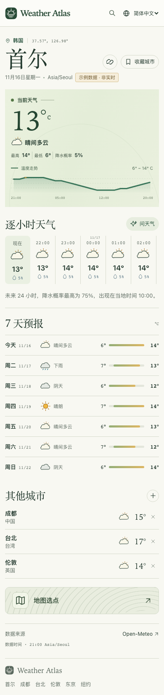
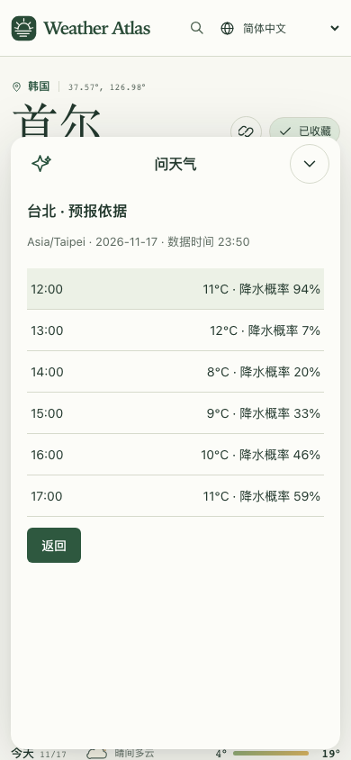

# 验收摘要与原始证据索引

当前版本的 Git 跟踪范围保留验收报告、精简结构化摘要和少量代表性截图。原始日志、完整天气／模型快照、单次性能输出、设备运行状态和其余截图均保留在本机 `qa/evidence/`，停止 Git 跟踪。重新运行 QA 后的输出也不进入提交。本次使用独立清理提交，不改写既有提交历史。

## 长期保留的结论

- [Review F-01～F-07 修复与取舍](review-repairs.md)：分批提交、刷新错误、异常守卫、缓存配置隔离、双端契约、Hooks 门禁与语义色值；生产浏览器 49 项及各自验收边界。

- [Flutter 城市名称恢复](flutter-reverse-recovery.md)：四语按钮、有界重试、前台与系统语言、75 项测试、双平台 HTTP 和普通安装包。

- [坐标名称恢复](reverse-recovery.md)：截图坐标真实覆盖复现、行政区域补查、短退避与 Web 恢复、四语竞态、HTTPS 和新版源码。

- [迟到授权定位恢复](location-grant.md)：首次失败后允许的自动恢复、请求合并与手选取消、12 秒等待、回归证据与源码。

- [深圳默认城市与推荐](shenzhen-default.md)：深圳默认展示、六城指定顺序、四语入口、定位／SEO 回归、固定原生候选及构建交付。

- [默认城市 SEO 补漏](default-city-seo.md)：深圳／香港默认列表与公开路由不一致、旧链接 308、八城四语及 36 项 sitemap、坐标页边界和新版源码。

- [地图入口精简](map-entry-cleanup.md)：侧栏入口删除、顶部搜索地图路径、四语布局与加载流程、瓦片超时边界及新版源码。

- [选址加载态](selection-loading.md)：新地点天气占位、旧数据隔离、四语与窄屏、延迟与失败、原生加载回归及普通入口产物。

- [地图地名与简化](map-clean.md)：惠州中文名称、英文本地名称分缓存、双端移除地图天气、选点请求预算、回归与新版产物。此行为取代历史天气地图的天气标记方案。

- [TypeScript 类型复核](type-audit.md)：外部 JSON 与共享缓存校验、计划联合类型、any／非空断言门禁、剩余两处类型适配与本轮证据。
- [TypeScript 迁移](typescript.md)：脚本与组件迁移、严格配置及首次交付。

- [v1.1.2 天气地图](weather-map.md)：窗口扩大、真实 OSM 缓存转发、双端天气标记与选点预算、实际模拟器和普通入口产物。

- [Next.js 性能优化](next-performance.md)：其他城市有限预取、完整快照摘要复用、弹窗意图预热、同条件前后传输和切城数据及取舍。

- [首页默认定位](home-location.md)：当前位置优先于旧手选、授权／失败／竞态／深链复测，保留首页可索引与现有 AI 配置。
- [SEO 全面巡检与修复](seo-audit.md)：分享、地址配置、语言协商／缓存、故障页及 demo 索引冲突修复，HTTP／HTTPS 各 84 页面检查。
- [首页索引调整与验收](home-indexing.md)：四语首页允许索引、稳定正文、28 项 sitemap 及四宽度／恢复／定位复测。
- [SEO 元数据与结构化数据补验](seo-metadata.md)：入口缺项、JSON-LD 漏项、原始 HTML 与客户端导航复测。
- [v1.1.1 反向地理编码验收](reverse-geocoding.md)：新增实现、实际回归、取舍、安装包和原始证据位置。

- [精简验收摘要](summary.json)：代码回归、格式钩子、模型调用、缓存、地图 A/B、TTFB、SEO 与受控性能数据，保留各自时间与实验条件。
- [完整验收报告](../../qa/LOCAL-VERIFICATION.md)、[历史记录](../../qa/RESULTS.md)、[格式化说明](../FORMAT.md)、[本地 HTTPS](../../qa/LOCAL-HTTPS.md)。
- [原始文件校验清单](archive-manifest.json)：逐文件大小与 SHA-256，不包含原始快照正文或本机运行配置。

这里保存的是已发生的验收结果，不代表当前实时天气。受控模型、规则模式、真实上游、受控 RUM 和公网状态仍按原报告分别解释；没有用清理动作更新任何测试结论。

## 精选界面证据

以下两张保留为独立、稳定的基线副本，QA 再运行不会自动覆盖它们。其余屏幕、权限和设备截图留在本地原始记录中。

### 手机宽度天气界面



### 双城市问答的预报依据



## 获取和核对本地原始证据

文档中的原始记录链接统一指向下方索引，避免在源码仓库中链接不随 Git 提供的文件。表格路径表示恢复验收附件后的本地位置；查看完整数据需要已有本地记录或项目交付的 `Weather-Atlas-Verification-Evidence.zip`。

在有原始记录的项目目录，可以生成独立附件：

```bash
node qa/archive-evidence.ts /tmp/Weather-Atlas-Verification-Evidence.zip
```

在另一份项目检出目录恢复附件：

```bash
unzip /path/to/Weather-Atlas-Verification-Evidence.zip -d qa
```

不需要这些原始输出也能运行产品和常规测试。需要重新实测时使用 `qa/` 下的对应自动化脚本；真实模型、地图或设备专项仍需满足报告中列出的资源条件。旧失败样本的结论保留在验收报告中，完整上下文通过附件与校验清单复查。

## 本地原始证据

以下为清理前提交版本的固定清单。本机文件没有从磁盘删除，已有的未提交实验更新也完整保留；这些本地更新可能与表中基线不同，不纳入本次清理提交。之后产生的新记录不自动改变本次基线。

| 原始记录的本地路径 | 大小（B） | SHA-256 前缀 |
| --- | ---: | --- |
| <a id="record-c33a28f9f1a4"></a>`qa/evidence/android-apk-size.json` | 493 | `ee09b6c4add058de` |
| <a id="record-39976b97d382"></a>`qa/evidence/android-baseline-home.png` | 211967 | `4677b340fe9f59e1` |
| <a id="record-28cd21f7a603"></a>`qa/evidence/android-baseline-signature.log` | 307 | `5ae2bb8650b82efe` |
| <a id="record-7e0c25ff753a"></a>`qa/evidence/android-baseline-taipei.png` | 210574 | `2152afd12b9a6754` |
| <a id="record-677ea16d5606"></a>`qa/evidence/android-browser-location.json` | 441 | `310fafbfe0be7c95` |
| <a id="record-a6bd1e94260c"></a>`qa/evidence/android-browser.json` | 829 | `c21af4a3e2b0fb85` |
| <a id="record-e6a425b0d729"></a>`qa/evidence/android-chrome-evidence.png` | 252046 | `263572857221aab5` |
| <a id="record-47776c83d240"></a>`qa/evidence/android-chrome-keyboard-native.png` | 276676 | `46240b8d417feaf3` |
| <a id="record-eb629be24014"></a>`qa/evidence/android-chrome-keyboard.png` | 151505 | `a70dda6c87d29fc9` |
| <a id="record-bd92ad05bb12"></a>`qa/evidence/android-final-home.png` | 202590 | `2e468c994613ea55` |
| <a id="record-5dea86465dec"></a>`qa/evidence/android-location-prompt.png` | 194277 | `e74a6c3a98226e05` |
| <a id="record-f124fa509d9a"></a>`qa/evidence/android-model-before-ai-fresh-fix.log` | 13548 | `3bd3afc96cc21d7d` |
| <a id="record-8d509a126f17"></a>`qa/evidence/android-permission-denied.json` | 420 | `1744cfd80c6a914d` |
| <a id="record-ce7798efb614"></a>`qa/evidence/android-permission-granted.json` | 335 | `553bfcb6a288f0e2` |
| <a id="record-74ba5b608f67"></a>`qa/evidence/android-permission-timeout.json` | 400 | `9ecd90ebe026ac5b` |
| <a id="record-d06934732dd5"></a>`qa/evidence/android-resilience.json` | 1623 | `3693cee4f786a809` |
| <a id="record-e0ca1559823b"></a>`qa/evidence/android-resumed.png` | 212493 | `d683c29272f1ea5f` |
| <a id="record-e3a90a9bf282"></a>`qa/evidence/android-rules-before-scroll-fix.log` | 15932 | `9e3d32f7b363f4f4` |
| <a id="record-185f48ab2c5a"></a>`qa/evidence/android-rules-integration.log` | 10886 | `81a3ac19abdc60c3` |
| <a id="record-4160a62550de"></a>`qa/evidence/android-upgrade-after.json` | 468 | `b114226a1a5e7610` |
| <a id="record-0364f4f2940d"></a>`qa/evidence/android-upgrade-before.json` | 469 | `56e363b68b02f518` |
| <a id="record-419f33b98526"></a>`qa/evidence/android-upgraded-taipei.png` | 40881 | `5db324634338e747` |
| <a id="record-7729047c3dac"></a>`qa/evidence/ask-floating-1024.png` | 140736 | `32be7566bcfdd32a` |
| <a id="record-92b9fc07b9ae"></a>`qa/evidence/ask-floating-1440.png` | 183824 | `a4316f49708c2ce9` |
| <a id="record-d8add55f9716"></a>`qa/evidence/ask-floating-320.png` | 44751 | `fd0cd7ee3d51741d` |
| <a id="record-b891c5ddcff6"></a>`qa/evidence/ask-floating-390.png` | 53176 | `98cdf70ffb7a0009` |
| <a id="record-1903a530bbd6"></a>`qa/evidence/ask-floating-768.png` | 146470 | `91ef2133fc31475a` |
| <a id="record-4f5e80939131"></a>`qa/evidence/ask-floating-820.png` | 185235 | `a946d51336522b31` |
| <a id="record-c6afd930a306"></a>`qa/evidence/ask-floating-evidence.png` | 51988 | `4c9e47dbfff7d87e` |
| <a id="record-fa5e50a7c0de"></a>`qa/evidence/ask-floating.json` | 1824 | `cc4955757a622ad3` |
| <a id="record-def0f487db19"></a>`qa/evidence/browser-check.json` | 2162 | `c7f453057d5aa59c` |
| <a id="record-e03719617a41"></a>`qa/evidence/browser-resilience.json` | 356 | `603c9db5faac7d14` |
| <a id="record-b96eca31932e"></a>`qa/evidence/comparison-refreshed.png` | 84400 | `9ad49806a972fd0c` |
| <a id="record-a8fb71c4436d"></a>`qa/evidence/comparison-taipei.png` | 141384 | `628aeace2b35b2ff` |
| <a id="record-4eb7b888ad50"></a>`qa/evidence/default-cities.json` | 981 | `ebff4fb785386cac` |
| <a id="record-3f704bcbca04"></a>`qa/evidence/final-services.json` | 678 | `5fdf2d59388ce9af` |
| <a id="record-f3fa5e4dd611"></a>`qa/evidence/format-hook.json` | 850 | `e05813c265588c59` |
| <a id="record-531fd3c123fd"></a>`qa/evidence/formatting.json` | 1330 | `2311c5c2cba9a545` |
| <a id="record-456fb4aed016"></a>`qa/evidence/global-search.json` | 3741 | `5ecd58632b4567ef` |
| <a id="record-457b0d967e30"></a>`qa/evidence/ios-final-home.png` | 267405 | `f1572584a96d46bb` |
| <a id="record-358642919ed0"></a>`qa/evidence/ios-home.png` | 263485 | `eaba115a3322d0c7` |
| <a id="record-cc870d533020"></a>`qa/evidence/ios-location-denied.log` | 6010 | `998bd45357a7f721` |
| <a id="record-ce4f5128541e"></a>`qa/evidence/ios-location-granted.log` | 6010 | `051fbdc73f2fd109` |
| <a id="record-9bd29eb22321"></a>`qa/evidence/ios-model-integration.log` | 14644 | `260d42e9a548d840` |
| <a id="record-c059d4dde20d"></a>`qa/evidence/ios-permission-denied/0B370759-2B30-4F8A-9F16-71F2E61DDC2C.png` | 450699 | `8d9961875f71949e` |
| <a id="record-45806e95ccdc"></a>`qa/evidence/ios-permission-denied/manifest.json` | 639 | `b87a86df4e9bd546` |
| <a id="record-2eef57082d99"></a>`qa/evidence/ios-permission-en/7FAA756E-CD9F-4A3D-B981-CD0A31F2A309.png` | 474243 | `77ae221eca525386` |
| <a id="record-8230f16e6c9f"></a>`qa/evidence/ios-permission-en/manifest.json` | 639 | `8ff557e09a4c2282` |
| <a id="record-0fce2fa394c6"></a>`qa/evidence/ios-permission-granted/9B1B72B3-E5CC-4029-8FBF-FE211C1AE3A7.png` | 434309 | `3a87641087ca975b` |
| <a id="record-8ad364273caf"></a>`qa/evidence/ios-permission-granted/manifest.json` | 637 | `20ede1eb0f306593` |
| <a id="record-a25d95a72aa3"></a>`qa/evidence/ios-permission-ko/719401A8-F9C3-4AD2-88DE-F0907AA8A66E.png` | 474881 | `850331503f41aa0c` |
| <a id="record-2532d3523be9"></a>`qa/evidence/ios-permission-ko/manifest.json` | 639 | `5781dda53370f5c4` |
| <a id="record-af1159490b96"></a>`qa/evidence/ios-permission-languages.json` | 768 | `f84a6c1a00dfeb8d` |
| <a id="record-22d3faf42d6a"></a>`qa/evidence/ios-permission-ocr.json` | 3515 | `2035c42e43927aa9` |
| <a id="record-ef72738943c9"></a>`qa/evidence/ios-permission-restored.json` | 298 | `c78255aa90eb1867` |
| <a id="record-465b4eb6b3f8"></a>`qa/evidence/ios-permission-zh-Hant/0D290D00-2AA9-49D0-95D1-309AD9D554A5.png` | 453832 | `3c51886b7236f1e7` |
| <a id="record-77c52d618b5d"></a>`qa/evidence/ios-permission-zh-Hant/manifest.json` | 639 | `96fbf8c52ed72b29` |
| <a id="record-23c19667fec9"></a>`qa/evidence/ios-resilience.json` | 1619 | `d7aa2bc099233947` |
| <a id="record-a1a083369d33"></a>`qa/evidence/ios-resumed.png` | 273589 | `4757159c2963fcb8` |
| <a id="record-8ae841682930"></a>`qa/evidence/ios-rules-integration.log` | 13592 | `e2928a011f43c496` |
| <a id="record-2ed04389f065"></a>`qa/evidence/language-cache.json` | 318 | `2eef1d71e368d96f` |
| <a id="record-f575d4502c6c"></a>`qa/evidence/language-control.json` | 2220 | `90c6fd0dadefae22` |
| <a id="record-e0f5719a269d"></a>`qa/evidence/language-toolbar-en.png` | 3977 | `7e242bef88695b68` |
| <a id="record-196e796af227"></a>`qa/evidence/language-toolbar-zh-Hans.png` | 4815 | `71d7b7e8ea412a26` |
| <a id="record-015672d3a4c1"></a>`qa/evidence/lighthouse.json` | 374210 | `88a87c62bb9f93a7` |
| <a id="record-b7b31c260d60"></a>`qa/evidence/live-model-browser.json` | 200876 | `cbcd2f62d7468981` |
| <a id="record-10c738f15201"></a>`qa/evidence/live-model-browser.png` | 53105 | `0542ea1df62cb2a7` |
| <a id="record-96a5f789042d"></a>`qa/evidence/live-ttfb.json` | 7390 | `2ac90c2b24c1708f` |
| <a id="record-7b7a48922722"></a>`qa/evidence/live-upstream-counts.json` | 2378 | `b26207a22673e795` |
| <a id="record-035107c7929d"></a>`qa/evidence/live-weather-before-final-recheck.json` | 339 | `6780612ffa229a3b` |
| <a id="record-9d4edf00491b"></a>`qa/evidence/live-weather-before-network-change.json` | 332 | `befd7acb50d2f9e3` |
| <a id="record-afabfaf55dda"></a>`qa/evidence/live-weather.json` | 458 | `55b8f11efb60f7a4` |
| <a id="record-9e4b7a0fff05"></a>`qa/evidence/local-https.json` | 898 | `79f2b511a07275a0` |
| <a id="record-0e146c53b3dd"></a>`qa/evidence/local-https.png` | 98756 | `a1f186305d2357ab` |
| <a id="record-e66dbe6ed68b"></a>`qa/evidence/location-permissions.json` | 854 | `8500a4dae9fe5c6a` |
| <a id="record-0ce053be4c9a"></a>`qa/evidence/logs/android-baseline-build.log` | 1897 | `1e635a7853c63a41` |
| <a id="record-f1396133127c"></a>`qa/evidence/logs/android-baseline-isolated-build.log` | 560 | `59de07b2f7376134` |
| <a id="record-bb4c50ced05d"></a>`qa/evidence/logs/android-baseline-isolated-build.log.exit.json` | 349 | `2cf4bae4c32283b4` |
| <a id="record-09cf4ab8a2a2"></a>`qa/evidence/logs/android-final-build-before-repack.log` | 310 | `7cf0061c11920c25` |
| <a id="record-3d0e7e41acbe"></a>`qa/evidence/logs/android-final-build.log` | 310 | `1a8de2326fd48172` |
| <a id="record-b74efd391b2d"></a>`qa/evidence/logs/android-final-build.log.exit.json` | 462 | `3f3e6c34e43d9972` |
| <a id="record-7e86ce5d9e06"></a>`qa/evidence/logs/android-licenses.log` | 401 | `bd5f070c2165eedd` |
| <a id="record-ee49b90ea437"></a>`qa/evidence/logs/android-live-model-integration.log` | 14790 | `6e417c6f45cefded` |
| <a id="record-420b15bad1c9"></a>`qa/evidence/logs/android-location-denied.log` | 5088 | `c18130fed0e6f136` |
| <a id="record-b26a106cee3c"></a>`qa/evidence/logs/android-location-granted-retest.log` | 10409 | `fa535a1c4c465d06` |
| <a id="record-9e36882f9d37"></a>`qa/evidence/logs/android-location-granted.log` | 10809 | `bc40df45ab7f7063` |
| <a id="record-23d2c0647bdb"></a>`qa/evidence/logs/android-location-timeout.log` | 6922 | `243ffde2a33f808c` |
| <a id="record-62d9a10f173a"></a>`qa/evidence/logs/android-model-integration.log` | 16652 | `823afb1ccef2802a` |
| <a id="record-60aab58f0e7f"></a>`qa/evidence/logs/android-permission-denied.log` | 165 | `5ad96af6bc3f00d8` |
| <a id="record-8cc1a999592c"></a>`qa/evidence/logs/android-permission-granted.log` | 78 | `c42f4a1137b90508` |
| <a id="record-53b74679bcf9"></a>`qa/evidence/logs/android-permission-timeout.log` | 145 | `b2b49c94011cf6e0` |
| <a id="record-a39099afaea7"></a>`qa/evidence/logs/android-resilience.log` | 13489 | `0bfd9ab7a591d58a` |
| <a id="record-96c5359e63dc"></a>`qa/evidence/logs/android-rules-integration.log` | 10844 | `810e104c650ef5f6` |
| <a id="record-d4422c99951e"></a>`qa/evidence/logs/build-tools-35-download.log` | 231 | `1a633b8e25e1513d` |
| <a id="record-9711731806c1"></a>`qa/evidence/logs/flutter-analyze.log` | 96 | `abef086526b90d55` |
| <a id="record-63e46feb1f72"></a>`qa/evidence/logs/flutter-doctor-final.log` | 3427 | `f26c609e1a28f9df` |
| <a id="record-c3cc21a6385f"></a>`qa/evidence/logs/flutter-tests-final.log` | 3080 | `499d109843a224b1` |
| <a id="record-7b9dd4c59b83"></a>`qa/evidence/logs/format-all.log` | 981 | `807bd74b8984410a` |
| <a id="record-5094c2c45063"></a>`qa/evidence/logs/format-check.log` | 522 | `26c4802690f7dbbd` |
| <a id="record-7437a1aa1a87"></a>`qa/evidence/logs/format-flutter-analyze.log` | 1330 | `43e28965ddab86d2` |
| <a id="record-189c953c5280"></a>`qa/evidence/logs/format-flutter-test.log` | 6658 | `53506f59486016fb` |
| <a id="record-fb1a438a520f"></a>`qa/evidence/logs/format-hook-check.log` | 738 | `5d7a53b9c6afd99b` |
| <a id="record-d5e6cd755e3e"></a>`qa/evidence/logs/format-npm-install.log` | 65 | `a734f6602385eaff` |
| <a id="record-85b69ef0950a"></a>`qa/evidence/logs/format-setup.log` | 1843 | `0688bf100ec5a290` |
| <a id="record-faf353d2a24d"></a>`qa/evidence/logs/format-web-build.log` | 1604 | `f0cda694787228b4` |
| <a id="record-135ae9e2f5c9"></a>`qa/evidence/logs/format-web-tests.log` | 5380 | `e73212f8b4c16c72` |
| <a id="record-d0935682ac18"></a>`qa/evidence/logs/ios-language-permissions.log` | 178 | `39bb453f50e05ce4` |
| <a id="record-6312e7c5ef24"></a>`qa/evidence/logs/ios-live-model-integration.log` | 13844 | `c4f059d457fd453e` |
| <a id="record-bd18b03415f9"></a>`qa/evidence/logs/ios-main-final.log` | 576 | `5fc771b73f696a7b` |
| <a id="record-d1a5bea9a222"></a>`qa/evidence/logs/ios-permission-denied-ui-final.log` | 117235 | `d12b2b9f44cd4afd` |
| <a id="record-bd9c9fb8bc3b"></a>`qa/evidence/logs/ios-permission-denied-ui.log` | 121969 | `4d5ee3392d6d40a2` |
| <a id="record-30d899a6af4b"></a>`qa/evidence/logs/ios-permission-en.log` | 6237 | `413260b1203bf07b` |
| <a id="record-54e1a24b4f93"></a>`qa/evidence/logs/ios-permission-granted-ui-final.log` | 18203 | `d1b14655e266a5cc` |
| <a id="record-c86367f04b97"></a>`qa/evidence/logs/ios-permission-ko.log` | 6617 | `a6698fec1d69dfbb` |
| <a id="record-7f751f7ab9aa"></a>`qa/evidence/logs/ios-permission-ui.log` | 138958 | `f24d341eca862b8d` |
| <a id="record-5dd609b8e3cf"></a>`qa/evidence/logs/ios-permission-zh-Hant.log` | 6248 | `6e307e2d0640a836` |
| <a id="record-c78444306a8b"></a>`qa/evidence/logs/ios-release-final.log` | 366 | `4b5f34b5c2569b3d` |
| <a id="record-8239948240f0"></a>`qa/evidence/logs/ios-resilience.log` | 12869 | `c871b688baf796c2` |
| <a id="record-5dc8717b8a4f"></a>`qa/evidence/logs/ios-rules-integration-final.log` | 11908 | `be8937d67dcc0139` |
| <a id="record-1298aadf93a2"></a>`qa/evidence/logs/ios-share-final.log` | 116330 | `a734bec024b0e1bc` |
| <a id="record-175b5f914e0e"></a>`qa/evidence/logs/live-model-browser.log` | 1025 | `aa26e5c6c4e7466b` |
| <a id="record-ef6df62e18df"></a>`qa/evidence/logs/live-weather-final.log` | 311 | `1d9f4bbc69f2e349` |
| <a id="record-8dd3807b50f3"></a>`qa/evidence/logs/native-artifacts-final.log` | 2027 | `8a1984260ab337ba` |
| <a id="record-16a4a07dcc99"></a>`qa/evidence/logs/node-tests-final.log` | 4611 | `1cb0d240a762e7f4` |
| <a id="record-bcc2c9f01f54"></a>`qa/evidence/logs/platform-35-base-download.log` | 256 | `4f71c9f99e080949` |
| <a id="record-1954b229d5e5"></a>`qa/evidence/logs/seo-live-real-retest.log` | 66 | `b8bc6a2203d69a80` |
| <a id="record-5332a4717b63"></a>`qa/evidence/logs/seo-live-real.log` | 570 | `c9003d92eff7f721` |
| <a id="record-24302158cbcf"></a>`qa/evidence/logs/smoke-final.log` | 505 | `2bc2d3c15bef9813` |
| <a id="record-450fd1d0011f"></a>`qa/evidence/logs/smoke-live-final.log` | 511 | `a05314f13c23a079` |
| <a id="record-ea50d86a5bed"></a>`qa/evidence/logs/web-build-final.log` | 1023 | `e4cd6409e575b82d` |
| <a id="record-6f6cf390e450"></a>`qa/evidence/map-en.png` | 76727 | `5728f8823698dc59` |
| <a id="record-f2873dad66c0"></a>`qa/evidence/map-ko.png` | 71141 | `919ebc360a5636a4` |
| <a id="record-7d7cccec21d9"></a>`qa/evidence/map-performance.json` | 2529 | `20f08a8651a6c04b` |
| <a id="record-02761744a475"></a>`qa/evidence/map-resources.json` | 1389 | `b2476f6381c677a1` |
| <a id="record-b0b4430d987d"></a>`qa/evidence/map-zh-Hans.png` | 79941 | `e6b5748724684dcb` |
| <a id="record-53dd574c8d4e"></a>`qa/evidence/map-zh-Hant.png` | 76314 | `52b5b1017d0d95c1` |
| <a id="record-ec9a10f24ea9"></a>`qa/evidence/mobile-maven-manifest.json` | 2696 | `79060bbefbf58c2f` |
| <a id="record-4d804db8bf9a"></a>`qa/evidence/model-browser.json` | 199134 | `af6d122acc14b38d` |
| <a id="record-39f170198875"></a>`qa/evidence/model-browser.png` | 55970 | `9c966d889c931f51` |
| <a id="record-945b89803751"></a>`qa/evidence/model-calls.json` | 20758 | `8c449ba1dd0744aa` |
| <a id="record-52a08be15290"></a>`qa/evidence/model-context.json` | 297078 | `c009d433fefd18a6` |
| <a id="record-c1d10c002985"></a>`qa/evidence/model-failures.json` | 389 | `b9056fb52be945d0` |
| <a id="record-02da7d174aef"></a>`qa/evidence/model-shared-limit.json` | 1107 | `813e2836822df896` |
| <a id="record-c6e94390c19d"></a>`qa/evidence/native-artifacts.json` | 2443 | `266f91a1bbe0c385` |
| <a id="record-6a02fe462a73"></a>`qa/evidence/native-network-android-live-model.json` | 224625 | `8e5359beba6c8ba1` |
| <a id="record-9298cb980ab0"></a>`qa/evidence/native-network-android-model.json` | 222873 | `df12dff742f57ce2` |
| <a id="record-e3eb0b87a1f1"></a>`qa/evidence/native-network-android-rules.json` | 221858 | `12c48e96cd3e0cf5` |
| <a id="record-05306a7c5ac3"></a>`qa/evidence/native-network-ios-live-model.json` | 224627 | `e5ba9e06e93c433a` |
| <a id="record-3eef3993ffe5"></a>`qa/evidence/native-network-ios-rules.json` | 221860 | `f33c330049affd8e` |
| <a id="record-2132fae4aaf1"></a>`qa/evidence/network-recovery.json` | 593 | `876ba262bb39cf1e` |
| <a id="record-72b20350dec2"></a>`qa/evidence/real-model-before-city-fix.json` | 739336 | `4d5e9bd620c19869` |
| <a id="record-4651322f6198"></a>`qa/evidence/real-model-before-fix.json` | 216210 | `eadca17243dc1f93` |
| <a id="record-a3170841d296"></a>`qa/evidence/real-model.json` | 807333 | `837ba7a5296de0b5` |
| <a id="record-47d3d2c0e8a4"></a>`qa/evidence/recovery.png` | 100889 | `e642ffd54b3de924` |
| <a id="record-e9695cbf8437"></a>`qa/evidence/reverse-android.json` | 2892 | `dc9c4ca50ccd5786` |
| <a id="record-96af906a523c"></a>`qa/evidence/reverse-browser.json` | 2402 | `eb3af0acfbac8590` |
| <a id="record-5b26b34af297"></a>`qa/evidence/reverse-ios.json` | 4303 | `fb77ba8cd566f806` |
| <a id="record-f37c6051ef49"></a>`qa/evidence/reverse-live-before-timeout-fix.json` | 3041 | `8dd7bedc9cee37a4` |
| <a id="record-007c3561ed84"></a>`qa/evidence/reverse-live.json` | 7896 | `e4d3de0ff9b772da` |
| <a id="record-ad29d34a0442"></a>`qa/evidence/reverse-web-1440.png` | 191715 | `f9f31e49353ea16c` |
| <a id="record-46deb98eb9f9"></a>`qa/evidence/reverse-web-390.png` | 102827 | `44b7fbbbcd420f7c` |
| <a id="record-655c3fad20e2"></a>`qa/evidence/rum-controlled.json` | 797 | `710383ed32e5385e` |
| <a id="record-e7f2a6a1a5c3"></a>`qa/evidence/seo-demo.json` | 7528 | `d9c7f5fb26493f01` |
| <a id="record-6ef05e03d960"></a>`qa/evidence/seo-live-fixture.json` | 7588 | `9725fe2879cb43e6` |
| <a id="record-fe12dd901d36"></a>`qa/evidence/seo-live-real.json` | 7588 | `d0b6ded3e133f15a` |
| <a id="record-050593bb05b3"></a>`qa/evidence/seo-live.json` | 7588 | `9725fe2879cb43e6` |
| <a id="record-366314b77202"></a>`qa/evidence/shared-instances.json` | 1852 | `b4154e83087bdc38` |
| <a id="record-11cd73a1f978"></a>`qa/evidence/sharing.json` | 572 | `82ea37295cb9b247` |
| <a id="record-dd82a0cd78d8"></a>`qa/evidence/stable-local-address.json` | 1493 | `ce9d4c0de570984e` |
| <a id="record-a3e1d0026e0d"></a>`qa/evidence/tile-integrity.json` | 1501 | `f95cd6e5ec18315f` |
| <a id="record-33955064ea65"></a>`qa/evidence/ttfb.json` | 6253 | `ad4415bc3cb5b350` |
| <a id="record-a94bb85b93f9"></a>`qa/evidence/web-1024.png` | 199795 | `3ff81c49a9932c94` |
| <a id="record-6bfecc295f20"></a>`qa/evidence/web-1440.png` | 224987 | `9e5d62cc06b6daf0` |
| <a id="record-c6b20fb3785e"></a>`qa/evidence/web-390.png` | 148190 | `c27df23f9df0e471` |
| <a id="record-4b94a233bad6"></a>`qa/evidence/web-768.png` | 183523 | `0b3d33a69f89046b` |

- [TypeScript 迁移验收与取舍](typescript.md)：严格类型、脚本迁移、回归和源码交付。
